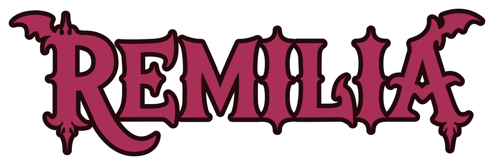

<!-- i18n:nav -->
[English](../../README.md) | [Português (Brasil)](../pt-BR/README.md) | **日本語** | [Español](../es/README.md)
<!-- /i18n:nav -->

<!-- i18n:meta -->
> - **Translation status:** Current
> - **Language:** ja
> - **Original language:** English
> - **Source:** [README.md](../../README.md)
> - **Source revision:** sha256:ec08f1cc3da745d72fc40b8c849f820b151209ebb28bdb02bc47416fe9ce0003
<!-- /i18n:meta -->

<!-- readme:logo -->

  <picture>
    <source media="(prefers-color-scheme: dark)" srcset="../../docs/public/brand/remilia-wordmark-3.svg">
    
  </picture>

<!-- /readme:logo -->

# Remilia Browser

**Project SCARLET** — Firefox（Gecko）と LibreWolf をベースに構築された、
プライバシー重視のデスクトップブラウザです。レミリア・スカーレットに着想を得た
独自のアイデンティティを持ちます。

> **ステータス：開発中。** 調査は完了し、ビルド基盤もありますが、Remilia の
> ビルドはまだ存在しません。最初のフルビルドは、ブランディング、セキュリティ、
> プライバシーが統合された時点で行う予定です。以下に記載されている内容は、
> いずれもリリース済みの機能ではありません。進捗は [ROADMAP.md](ROADMAP.md) で
> 管理しています。

## Remilia とは

- **本物のブラウザ**：Gecko によるレンダリング、Firefox のネットワークスタック、
  マルチプロセスとサイト分離、Windows サンドボックス、Firefox 拡張機能との
  互換性。これらはすべて無変更で使用します。
- **LibreWolf のプライバシー基盤**：ビルド時に除去されたテレメトリ、
  「厳格」モードの強化型トラッキング防止、包括的 Cookie 保護、
  resistFingerprinting、HTTPS-Only モード。
- **uBlock Origin を内蔵**：AMO の署名付きの本物の拡張機能をプリインストールし、
  ブラジル向けの地域リストを含む妥当なデフォルトリストを設定します。
- **独自のアイデンティティ**：スカーレットをアクセントにした、ゴシック調の
  オリジナルブランディング。原作への言及は控えめで、東方を知らない人にも
  プロフェッショナルに見える UI を目指します。

## Remilia ではないもの

WebView のラッパーでも、Electron でも、新しいエンジンでも、匿名化ツールでも
ありません。何から保護し、何から保護しないかについては
[PRIVACY.md](PRIVACY.md) を参照してください。

## ドキュメント

| ドキュメント | 内容 |
|---|---|
| [ARCHITECTURE.md](ARCHITECTURE.md) | ベースの選定、レイヤーモデル、ビルドパイプライン、広告ブロックとアップデートの設計 |
| [PRIVACY.md](PRIVACY.md) | 設定項目ごとのプライバシー評価、LibreWolf との相違点 |
| [SECURITY.md](SECURITY.md) | セキュリティモデル、相違点、サプライチェーン、未解決の課題 |
| [BUILD.md](BUILD.md) | 要件とビルド手順（Windows x64） |
| [UPSTREAM.md](UPSTREAM.md) | Firefox と LibreWolf のリリースへの追従 |
| [ROADMAP.md](ROADMAP.md) | フェーズ、タスクの状況、ブロッカー |
| [CONTRIBUTING.md](CONTRIBUTING.md) | プロジェクトへの参加方法 |

## クレジットとライセンス

Remilia は Mozilla Firefox（MPL-2.0）と LibreWolf（MPL-2.0）をベースに構築されて
おり、uBlock Origin（GPL-3.0、無変更で配布）を同梱します。「Firefox」は Mozilla の
商標であり、Remilia の名称やブランディングには使用しません。

Remilia 独自のオリジナルファイルは Mozilla Public License 2.0
（[LICENSE](../../LICENSE)）でライセンスされます。Firefox、LibreWolf その他の
第三者コンポーネントから継承したファイルは、それぞれのライセンスと表示を保持し、
Remilia はそれらを変更しません。

東方Project およびレミリア・スカーレットは ZUN／上海アリス幻樂団による創作物です。
Remilia はファンの着想による独立したプロジェクトです。公式アートワークは一切使用
しておらず、Remilia のビジュアル素材はすべてオリジナルです。
