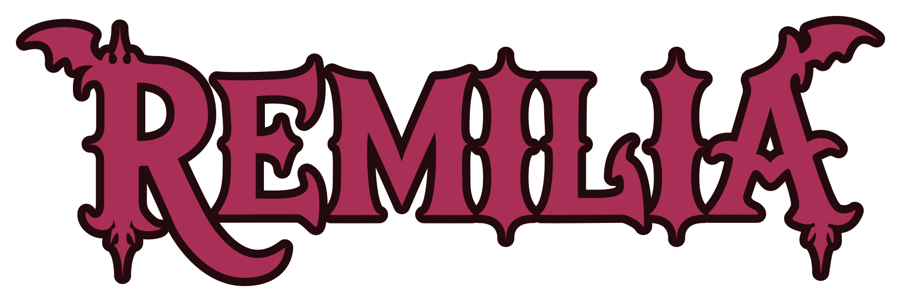

<!-- i18n:nav -->
[English](../../README.md) | **Português (Brasil)** | [日本語](../ja/README.md) | [Español](../es/README.md)
<!-- /i18n:nav -->

<!-- i18n:meta -->
> - **Translation status:** Current
> - **Language:** pt-BR
> - **Original language:** English
> - **Source:** [README.md](../../README.md)
> - **Source revision:** sha256:ec08f1cc3da745d72fc40b8c849f820b151209ebb28bdb02bc47416fe9ce0003
<!-- /i18n:meta -->

<!-- readme:logo -->

  <picture>
    <source media="(prefers-color-scheme: dark)" srcset="../../docs/public/brand/remilia-wordmark-3.svg">
    
  </picture>

<!-- /readme:logo -->

# Remilia Browser

**Project SCARLET** — um navegador desktop focado em privacidade, construído
sobre o Firefox (Gecko) e o LibreWolf, com identidade própria inspirada em
Remilia Scarlet.

> **Status: em desenvolvimento.** A pesquisa está concluída e a infraestrutura
> de build existe, mas ainda não há nenhuma build do Remilia: a primeira build
> completa está planejada para quando branding, segurança e privacidade
> estiverem integrados. Nada abaixo é um recurso já lançado. O progresso é
> acompanhado em [ROADMAP.md](ROADMAP.md).

## O que o Remilia é

- Um **navegador de verdade**: renderização Gecko, a pilha de rede do
  Firefox, multiprocessos e isolamento de sites, a sandbox do Windows e
  compatibilidade com extensões do Firefox, tudo sem modificações.
- **A base de privacidade do LibreWolf**: telemetria removida em tempo de
  compilação, Proteção Aprimorada contra Rastreamento no modo Rigoroso,
  Proteção Total de Cookies, resistFingerprinting e Modo Somente HTTPS.
- **uBlock Origin integrado**: a extensão real, assinada pela AMO,
  pré-instalada, com listas padrão sensatas, incluindo cobertura regional para
  o Brasil.
- **Identidade própria**: branding original, gótico e com detalhes em
  escarlate. A referência é sutil, e a interface tem aparência profissional
  mesmo para quem nunca ouviu falar de Touhou.

## O que o Remilia não é

Não é um wrapper de WebView, não é Electron, não é um novo motor e não é uma
ferramenta de anonimato. Veja [PRIVACY.md](PRIVACY.md) para saber contra o que
ele protege e contra o que não protege.

## Documentação

| Documento | Conteúdo |
|---|---|
| [ARCHITECTURE.md](ARCHITECTURE.md) | Escolha da base, modelo de camadas, pipeline de build, design do bloqueio de anúncios e das atualizações |
| [PRIVACY.md](PRIVACY.md) | Avaliação de privacidade configuração por configuração, divergências em relação ao LibreWolf |
| [SECURITY.md](SECURITY.md) | Modelo de segurança, divergências, cadeia de suprimentos, problemas em aberto |
| [BUILD.md](BUILD.md) | Requisitos e procedimento de build (Windows x64) |
| [UPSTREAM.md](UPSTREAM.md) | Acompanhamento das versões do Firefox e do LibreWolf |
| [ROADMAP.md](ROADMAP.md) | Fases, status das tarefas, bloqueios |
| [CONTRIBUTING.md](CONTRIBUTING.md) | Como trabalhar no projeto |

## Créditos e licenciamento

O Remilia é construído sobre o Mozilla Firefox (MPL-2.0) e o LibreWolf
(MPL-2.0), e inclui o uBlock Origin (GPL-3.0, distribuído sem modificações).
"Firefox" é uma marca registrada da Mozilla e não é usada no nome nem no
branding do Remilia.

Os arquivos originais do próprio Remilia são licenciados sob a Mozilla Public
License 2.0 ([LICENSE](../../LICENSE)). Os arquivos herdados do Firefox, do
LibreWolf e de outros componentes de terceiros mantêm suas próprias licenças e
avisos, que o Remilia não altera.

Touhou Project e Remilia Scarlet são criações de ZUN / Team Shanghai Alice.
O Remilia é um projeto independente inspirado por fãs. Ele não usa nenhuma arte
oficial, e todos os seus recursos visuais são originais.
